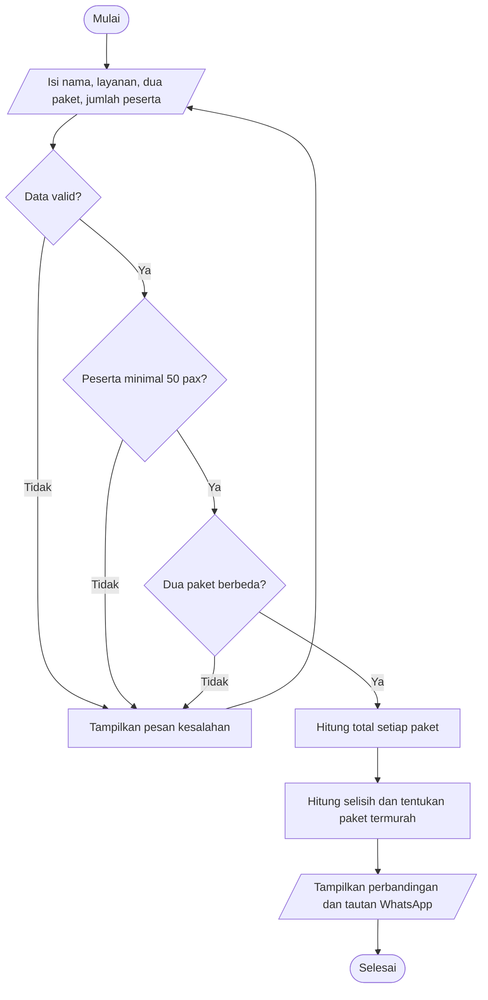

# Kalilla Event Planner

Website event planner satu halaman menggunakan Python Flask. Empat bagian utamanya adalah Home, Services, Portfolio, dan Contact. Form estimasi booking tersedia di bagian Contact dan dapat dilanjutkan ke WhatsApp.

## Menjalankan dari VS Code

1. Buka folder `kalilla-event-planner` di VS Code.
2. Buka terminal VS Code (**Terminal > New Terminal**).
3. Buat virtual environment dan aktifkan:

   ```powershell
   py -m venv .venv
   .venv\Scripts\Activate.ps1
   ```

   Jika PowerShell memblokir aktivasi, jalankan `.\.venv\Scripts\python.exe` untuk perintah Python di langkah berikutnya.
4. Instal Flask:

   ```powershell
   python -m pip install -r requirements.txt
   ```

5. Jalankan aplikasi:

   ```powershell
   python app.py
   ```

6. Buka alamat yang muncul di terminal, biasanya <http://127.0.0.1:5000>.

## Peta materi Python

| Materi | Contoh dalam proyek |
|---|---|
| Algoritma & pemrograman | `bandingkan_paket()` menghitung total dua paket, selisih biaya, dan paket dengan total termurah. |
| Kondisi logika & flowchart | `validasi_input()` memeriksa data, minimal 50 peserta, dan memastikan dua paket berbeda. `bandingkan_paket()` menentukan paket termurah dengan `if/elif/else`. |
| List dan array | `SERVICES`, `PACKAGES`, `PORTFOLIO`, serta list `errors` menyimpan kumpulan data. |
| Variabel, tipe data & operasi | Konstanta `str`, `int`, `bool`, konversi `int()`, perkalian harga per pax dengan peserta, dan pengurangan total untuk selisih. |
| Function | `cari_layanan()`, `cari_paket()`, `validasi_input()`, dan `bandingkan_paket()` membagi program menjadi fungsi. |
| Looping | `for` mencari layanan dan paket; `` di template menampilkan card, opsi paket, dan foto. |

### Flowchart alur estimasi booking



## Catatan sebelum digunakan untuk bisnis

- Daftar `PACKAGES` berisi empat harga dari foto Harga 1 dan Harga 2: Rp370.000, Rp440.000, Rp310.000, dan Rp350.000 per pax. Fitur membandingkan dua paket untuk jumlah peserta yang sama, menampilkan total, selisih, dan paket berbiaya paling rendah. Semua paket menggunakan minimum 50 pax sesuai konfirmasi; tidak ada diskon atau biaya tambahan dalam simulasi.
- Foto portfolio menggunakan foto lokal di `static/images/`, termasuk foto kegiatan Event Organizer. Foto hero masih dimuat dari Unsplash dan memerlukan koneksi internet.
- Portfolio berisi enam contoh, masing-masing dua untuk Biro Tour & Gathering, Consultan trip, dan Event Organizer.
- Informasi WhatsApp, Instagram, dan email dapat diubah pada konstanta di bagian atas `app.py`.
